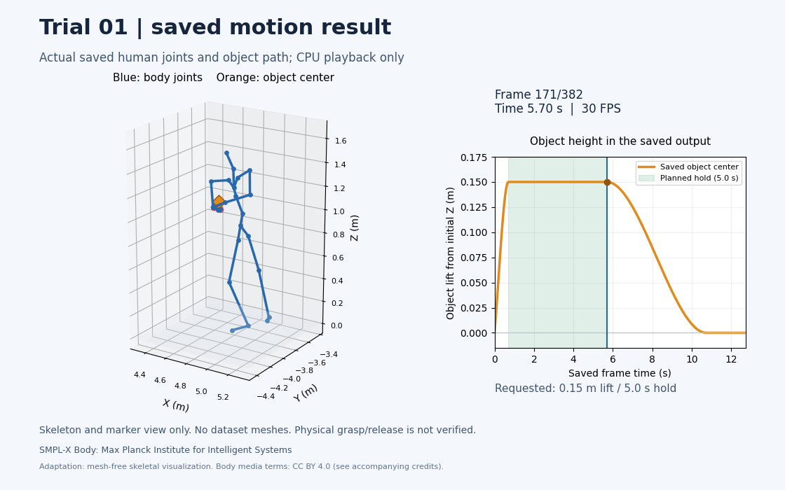
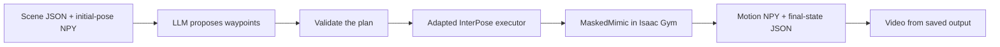

# Trial 01 — Lift a floorlamp, hold it, and save the motion

I used **InterPose** to generate a human motion sequence: lift a floorlamp by **15 cm**, hold it for **5 seconds**, return it to its starting position, and move both hands away. The completed run is named **`lift_hold_001`**.

This page shows what I did, the files I obtained, and how to try the same workflow on another computer. The instructions below use the portable version of my launcher in this repository. My original run used an earlier local version; a complete GPU/API run of this portable version has not yet been repeated on a clean machine.

## Result video

[**Watch the Trial 01 result — lift_hold_001**](media/trial_01/preview_trial_01.mp4)

[](media/trial_01/preview_trial_01.mp4)

This video is made from the **actual saved output**, with 383 frames at 30 FPS (about 12.77 seconds). The skeleton shows saved human joint positions; the orange marker shows the saved floorlamp center. The five-second hold is one part of the sequence, not the total video length.

I use a skeleton and an object-center marker so the preview needs no body or scene mesh files. The lamp path is generated by the interaction pipeline; this video does not demonstrate a physical grasp or successful lifting by contact forces. SMPL-X Body credit: **Max Planck Institute for Intelligent Systems**; see [video credits and provenance](media/README.md).

## What I asked the system to do

The original instruction in my scene JSON was:

> Stay in place. Pick up the floorlamp and lift it vertically by 0.15 meters without changing its horizontal position. Hold it upright at the raised position for 5 seconds. Then lower it gently to its original position on the floor, let it settle, and move both hands away. The initial and final floorlamp CENTER position is [4.636, -3.783, 0.899] meters in scene-normalized Z-up coordinates. Do not walk or carry it elsewhere. Use ONE generate_interaction call with task_index=1, then finish.

The coordinates belong to this prepared scene. For another scene, read its actual initial object center rather than copying these numbers.

The flow is:



`trial_01` uses a structured planner around InterPose's adapted executor and official MaskedMimic evaluation. The planner proposes data; the executor implements the motion behavior. This experiment starts from a prepared scene and initial pose. It does not take an input video or run the complete original multi-step HOI-Agent loop.

## 1. Prepare the software and assets

You need a Linux computer with an NVIDIA GPU, **two prepared Python environments**, and the external assets below. Download and install them following [the full setup guide](docs/FULL_SETUP.md) before running the generation commands.

| Needed | Used for |
| --- | --- |
| Pinned InterPose and ProtoMotion sources with the supplied patches | Interaction code and simulator backend |
| PyTorch3D, human_body_prior, BPS, and other InterPose dependencies | Body reconstruction and geometry |
| Isaac Gym Preview 4 and its simulator environment | MaskedMimic inference |
| SMPL-X male/female models and SMPL model files | Human representation |
| MaskedMimic `last.ckpt` and matching `config.yaml` | Pretrained motion controller |
| InterPose processed data | Initial pose, scene information, and object geometry |
| OpenAI API access with billing | The `gpt-4o` planner |

My working environments were:

| | InterPose / planner | Simulator |
| --- | --- | --- |
| Python | 3.8.20 | 3.8.20 |
| PyTorch | 2.0.0, CUDA runtime 11.7 | 2.2.0, CUDA runtime 11.8 |
| NumPy | 1.24.3 | 1.23.5 |

The [environment inventories](environments/) record the other observed packages. They are references, not a verified one-command installation for every computer. Installing only `requirements-offline.txt` does **not** install this full generation pipeline. Models, SDKs, checkpoints and processed data must be obtained separately under their terms.

Clone this companion repository and prepare the pinned source code:

```bash
git clone https://github.com/badriawan/interpose-experiments.git
cd interpose-experiments
python3 scripts/prepare_sources.py --fetch
```

The helper downloads source and applies the supplied patches. It does not install the environments or download the licensed assets. Finish [full setup](docs/FULL_SETUP.md) before continuing. Run the following commands in the same Bash terminal, from this repository's root directory.

## 2. Prepare the Trial 01 inputs

Use the original pair from InterPose's processed data:

```text
external/InterPose/processed_data/replica_new/frl_apartment_4/
  environment_state/sub17_floorlamp_001_pidx_0.json
  motion_data/sub17_floorlamp_001_pidx_0.npy
```

The **input JSON** describes the scene. The **input NPY** contains the initial human and object state. This initial-pose NPY is different from the full motion NPY produced at the end.

Copy that pair into a new private scene folder. The following block also adds the instruction and numeric goal to the copied JSON, using the actual center from your trusted initial NPY. It preserves the original files and refuses to overwrite existing copies.

Set the path to your prepared InterPose Python first:

```bash
INTERPOSE_PYTHON="/absolute/path/to/interpose-env/bin/python"

"$INTERPOSE_PYTHON" -I -B - <<'PY'
import json
from pathlib import Path
import numpy as np

source = Path("external/InterPose/processed_data/replica_new/frl_apartment_4")
scene = Path(".local/prepared_inputs/frl_apartment_4")
name = "sub17_floorlamp_001_pidx_0"
source_json = source / "environment_state" / (name + ".json")
source_npy = source / "motion_data" / (name + ".npy")
target_json = scene / "environment_state" / (name + ".json")
target_npy = scene / "motion_data" / (name + ".npy")
if target_json.exists() or target_npy.exists():
    raise SystemExit("Input copies already exist; preserve them or choose a fresh folder.")
state = json.loads(source_json.read_text())
initial = np.load(source_npy, allow_pickle=True).item()  # Trusted local dataset only.
center = np.asarray(initial["object"]["floorlamp"]["xyz"], dtype=float).tolist()
state["custom_instruction"] = (
    "Stay in place. Lift the floorlamp vertically by 0.15 meters, hold it upright "
    "for 5 seconds, return it gently to its initial position, let it settle, "
    "then move both hands away. Do not walk or carry it elsewhere."
)
state["custom_goal"] = {
    "object": "floorlamp", "action": "lift_hold_return_release",
    "center_xyz_m": center, "lift_height_m": 0.15, "hold_duration_s": 5.0,
    "release_after_placement": True, "settle_duration_s": 1.0,
    "hand_withdraw_duration_s": 1.0, "hand_withdraw_distance_m": 0.1,
}
target_json.parent.mkdir(parents=True, exist_ok=True)
target_npy.parent.mkdir(parents=True, exist_ok=True)
with target_npy.open("xb") as handle:
    handle.write(source_npy.read_bytes())
with target_json.open("x") as handle:
    json.dump(state, handle, indent=2, allow_nan=False)
print("Prepared scene:", scene.resolve())
PY
```

This is a shorter reproduction instruction with the same requested action. The exact historical wording is quoted above. Keep the scene name `frl_apartment_4`, the object name `floorlamp`, and the matching JSON/NPY basenames unchanged for this first attempt.

## 3. Set your local paths and API key

```bash
mkdir -p .local
cp -n configs/runtime.example.json .local/runtime.json
```

Edit `.local/runtime.json` with your paths. Set `data_root` to the **absolute path** printed in step 2. Set `interpose_python` to the same executable as `INTERPOSE_PYTHON`, and `simulator_python` to the other environment's Python. Fill the source, model, checkpoint, SMPLSim and SDK paths using [the configuration instructions](docs/FULL_SETUP.md#5-configure-local-paths).

Put your API key in the file named by `paths.key_file`, owned by your user with permission `600`. The JSON contains the **key-file path**, never the key itself. Only explicit execution reads that file and makes paid API calls.

```bash
"$INTERPOSE_PYTHON" -I -B scripts/configure_runtime.py --config .local/runtime.json
```

## 4. Check before generating

```bash
"$INTERPOSE_PYTHON" -I -B trial_01/launch_trial.py --preflight
"$INTERPOSE_PYTHON" -I -B trial_01/launch_trial.py --dry-run
```

Continue only when these report **`PREFLIGHT_PASS`** and **`DRY_RUN_PASS`**. They check local inputs and planning rules without calling the API or generating motion. If either fails, fix the reported issue first; see [troubleshooting](docs/TROUBLESHOOTING.md).

## 5. Generate one motion

For a new run:

```bash
mkdir -p .local/logs
set -o pipefail
"$INTERPOSE_PYTHON" -u -I -B trial_01/launch_trial.py \
  --execute --run-name lift_hold_001 \
  2>&1 | tee .local/logs/lift_hold_001.log
```

This calls the planner, validates its proposed waypoints, and runs one interaction through the executor and MaskedMimic. A successful run reports **`ARTIFACTS_VERIFIED`**. This means the expected files and checks passed; it does not certify physical task success.

Use a new name such as `lift_hold_002` for another attempt. Existing runs are preserved. My historical first launch reached the planner-proposal limit **before generation**. I then validated a saved response and resumed once, producing the completed clip. That run's success is in `resume_manifest.json`; its original `manifest.json` still records the initial failure. A fresh successful run normally records success in `manifest.json`. Recovery is a separate, restricted path described in [development](docs/DEVELOPMENT.md#recovery-and-publication), not a step to run automatically after every error.

## 6. Find the `.npy` and `.json` results

For `lift_hold_001`, the main files are:

```text
trial_01/runs/lift_hold_001/output/
  frl_apartment_4_sub17_floorlamp_001_0/
    sub17_floorlamp_001_pidx_0_task_0.npy
    sub17_floorlamp_001_pidx_0_task_0.json
    objs_mesh/
    maskedmimic_res/task_0/
      trajectory_pose_aa_0_0.npz
      stage10_raw_trajectory.npz
      execution_evidence.json
```

| File | What it contains |
| --- | --- |
| Task `.npy` | The saved motion: human joints/rotations, object positions/rotations, and metadata |
| Task `.json` | The final scene state and task information; it is not the full motion sequence |
| Simulator `.npz` and evidence | Supporting motion/recorder data and execution checks |
| `objs_mesh/` | Mesh frames produced by the executor, which can take substantial disk space |

To inspect your own trusted output:

```bash
"$INTERPOSE_PYTHON" -I -B - <<'PY'
from pathlib import Path
import json
import numpy as np

folder = Path("trial_01/runs/lift_hold_001/output/frl_apartment_4_sub17_floorlamp_001_0")
motion = np.load(folder / "sub17_floorlamp_001_pidx_0_task_0.npy", allow_pickle=True).item()
state = json.loads((folder / "sub17_floorlamp_001_pidx_0_task_0.json").read_text())
print("Motion keys:", list(motion))
print("Human joints:", motion["human"]["joint_xyz"].shape)
print("Floorlamp positions:", motion["object"]["floorlamp"]["xyz"].shape)
print("FPS:", motion["metadata"]["fps"])
print("Final-state JSON keys:", list(state))
PY
```

My clip has `human.joint_xyz` shape **`(1, 383, 24, 3)`** and `object.floorlamp.xyz` shape **`(1, 383, 3)`**. A new LLM run can produce a different frame count. The detailed conventions are in [output schema](docs/OUTPUT_SCHEMA.md). These files are generated locally and are not bundled with this repository. The NPY uses pickle: load only your own or otherwise trusted files.

## 7. Make a video from your result

The preview needs NumPy, Matplotlib, imageio and ffmpeg support. Use a separate CPU preview environment or the already prepared parent environment; the optional versions are listed in `requirements-media.txt`.

```bash
"$INTERPOSE_PYTHON" -I -B scripts/render_trial_result.py \
  --motion trial_01/runs/lift_hold_001/output/frl_apartment_4_sub17_floorlamp_001_0/sub17_floorlamp_001_pidx_0_task_0.npy \
  --output-dir trial_01/runs/lift_hold_001/preview \
  --trusted-input
```

Open `trial_01/runs/lift_hold_001/preview/preview_trial_01.mp4`. The script also saves a PNG and preview metadata. It reads the saved arrays; it does not call the LLM, reconstruct a mesh, or rerun the simulator. Rendering your own clip needs no Blender window.

## What worked, and what still needs improvement

I obtained the motion NPY, final-state JSON, simulator evidence and a viewable preview. The requested object hold is five seconds. However, the human pelvis drifted by about **20.7 cm**, and the hand markers moved away by about **4.35 cm / 5.03 cm** instead of the requested 10 cm. Physical grip/release and exact human/object phase synchronization remain unverified. I report this as a generated motion result with known limitations, not a fully successful physical task.

The original local preview included sampled body/object mesh vertices. The public result video above is a new, mesh-free view of the same saved trajectory. It does not replace the data or rerun generation. [Validation notes](docs/VALIDATION.md) explain the distinction between file checks, visual results and physical success.

## More information

- [Full installation and asset setup](docs/FULL_SETUP.md)
- [How to change a task or object](docs/DEVELOPMENT.md)
- [Output fields and coordinates](docs/OUTPUT_SCHEMA.md)
- [Troubleshooting](docs/TROUBLESHOOTING.md)
- [Independent CPU-only example](docs/GETTING_STARTED.md), if you only want to inspect waypoint validation before setting up the full runtime

Built on [InterPose](https://github.com/Mael-zys/InterPose). Its MIT notice and the simulator adapter's separate NVIDIA license are retained in [third_party](third_party/). Models, data and media have separate terms; see [licensing](docs/LICENSING.md).
