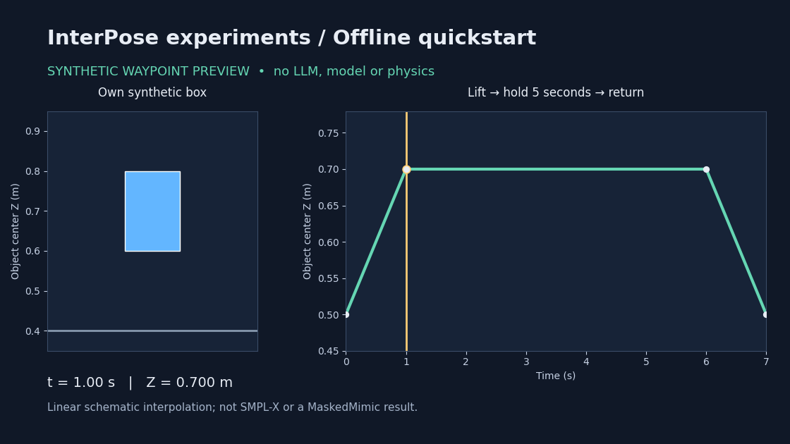

# InterPose Experiments

A documented companion repository for a bounded lift–hold–return experiment built on [InterPose](https://github.com/Mael-zys/InterPose). Start with a CPU-only waypoint example, then configure the research runtime when you have the required licensed assets and NVIDIA environment.

**Release scope:** the offline example validates planning data. It does not generate human motion. Full API/GPU reproduction of this portable release has not been rerun on a clean machine. See [validation](docs/VALIDATION.md) for the difference between current checks and historical results.

## Start here

```bash
git clone https://github.com/badriawan/interpose-experiments.git
cd interpose-experiments
python3.10 -m venv .venv
. .venv/bin/activate
python -m pip install -r requirements-offline.txt
python -I -B scripts/offline_demo.py
python -I -B -m unittest discover -s tests -v
```

Use Python 3.8–3.11 for the pinned NumPy 1.24.3 example. The report is written to `.local/offline_demo.json`; choose a fresh `--output .local/another_demo.json` if it already exists. The example uses our own synthetic box coordinates, the actual waypoint validator, and the trusted executor's frame-adjustment method. It needs no API key, scene, body model, simulator, or GPU.

[Watch the synthetic waypoint preview](media/offline_waypoints.mp4). This is a visualization of planned coordinates, **not** MaskedMimic output or evidence of a physical lift. The original floorlamp video is kept outside the public release pending asset-rights verification.



## What is included

| Path | Purpose |
| --- | --- |
| `trial_01/` | Structured planner, validators, adapted InterPose executor, and one-run orchestration |
| `runtime/` | Configurable bridge to official conversion and MaskedMimic evaluation |
| `patches/` | Pinned InterPose changes and the missing Isaac Gym backend adaptation |
| `configs/runtime.example.json` | Non-secret example of local runtime paths |
| `scripts/` | Offline demo, source preparation, and configuration checks |
| `manifests/` | Published code and dependency expectations |
| `trial_02/` | Planned official HOI-Agent baseline; not executed here |

The original SDK, SMPL/SMPL-X models, checkpoint, scene data, dense trajectories, private configuration, and generated runs are excluded. This is an independent experiment repository; it does not replace or claim to be the official InterPose release.

## Documentation

- [Getting started](docs/GETTING_STARTED.md): run the independent offline example.
- [Full research setup](docs/FULL_SETUP.md): source pins, environments, licensed assets, and live execution.
- [Pipeline](docs/PIPELINE.md): prompt, plan, executor, MaskedMimic, and outputs.
- [Output schema](docs/OUTPUT_SCHEMA.md): `.npy`, `.npz`, metadata, and ResMimic boundaries.
- [Development](docs/DEVELOPMENT.md): how to extend the experiment without losing evidence.
- [Troubleshooting](docs/TROUBLESHOOTING.md), [validation](docs/VALIDATION.md), and [licensing](docs/LICENSING.md).
- [Publishing status and final GitHub steps](docs/PUBLISHING.md).

## Attribution

InterPose code is Copyright (c) 2025 Yangsong ZHANG, under its [MIT license](third_party/InterPose-LICENSE.txt). The Isaac Gym backend adaptation contains NVIDIA-licensed source and retains its [separate license](third_party/ProtoMotion-NVIDIA-LICENSE.txt) and [provenance](third_party/isaacgym_backend_PROVENANCE.md). Asset and model terms remain separate; see [licensing](docs/LICENSING.md).
