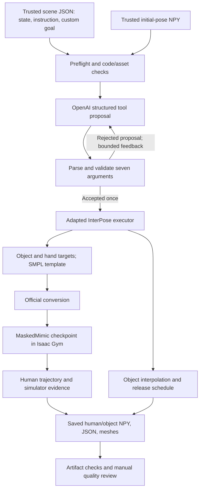

# Pipeline

The bounded `trial_01` flow uses InterPose's adapted interaction executor and official MaskedMimic evaluation. Its structured planner is a small controlled wrapper. It is not the complete original HOI-Agent multi-step loop, and it does not infer this exercise from a video.

## Input versus plan versus executor

The input JSON describes the scene and contains `custom_instruction` and a numeric `custom_goal`. JSON does not autonomously create a prompt: `launcher/core.py` combines those fields, known initial coordinates, and fixed planning rules into API messages.

The LLM proposes `control_joints`, `control_points`, `text`, `number_frames`, `task_index`, `object_name`, and `object_points`. On the API wire, each waypoint has named `frame`, `x`, `y`, and `z` fields. Local parsing converts it into the executor's `[frame,x,y,z]` rows. These are data; generated Python is not executed.

The validator restricts this exercise to one object, one lift/hold/return, fixed object X/Y, a fixed planned pelvis, and a precise requested hold duration at 30 Hz. It validates both the proposal and the executor's frame adjustment. Invalid proposals can be revised before dispatch, up to the configured three-attempt limit.

The executor supplies the implementation: target preparation, timing adjustments, grasp/contact heuristics, body-model reconstruction, object interpolation, placement/settle/withdraw schedule, and output writing. Changing the instruction alone cannot add unsupported executor behavior.

## What MaskedMimic does

MaskedMimic is a learned motion controller. The supplied checkpoint uses sparse motion constraints to produce simulated human motion. Here, the bridge runs the official converter and evaluator with hand conditioning, one environment, a finite evaluation, and headless Isaac Gym. This is inference, not training. The body model used for reconstruction is SMPL-X; simulator control and saved representation have their own conventions.

The simulator child records checkpoint loading, finite policy actions, raw trajectory buffers, and timing evidence. The saved object trajectory is produced by the interaction pipeline; its presence does not establish that simulated hands physically lifted an object with successful contact dynamics.

## Offline example and planned baseline

`scripts/offline_demo.py` stops at validating synthetic waypoints and the trusted frame-adjustment method. It does not enter the live diagram's API, template conversion, model, or simulation steps. Its video visualizes that synthetic plan.

`trial_02` is a separate plan to reproduce one official HOI-Agent baseline before comparing custom changes. It has no completed generation in this release.

## Downstream ResMimic boundary

A further pipeline would audit the human/object clip, map skeleton and coordinates to the target robot, retarget, smooth, resample, export the exact loader schema, and replay it before any policy evaluation. Renaming `.npy` to `.pkl` or `.npz` performs none of these steps. The historical downstream conversion is documented as context; its exporter and licensed output data are not included here.
